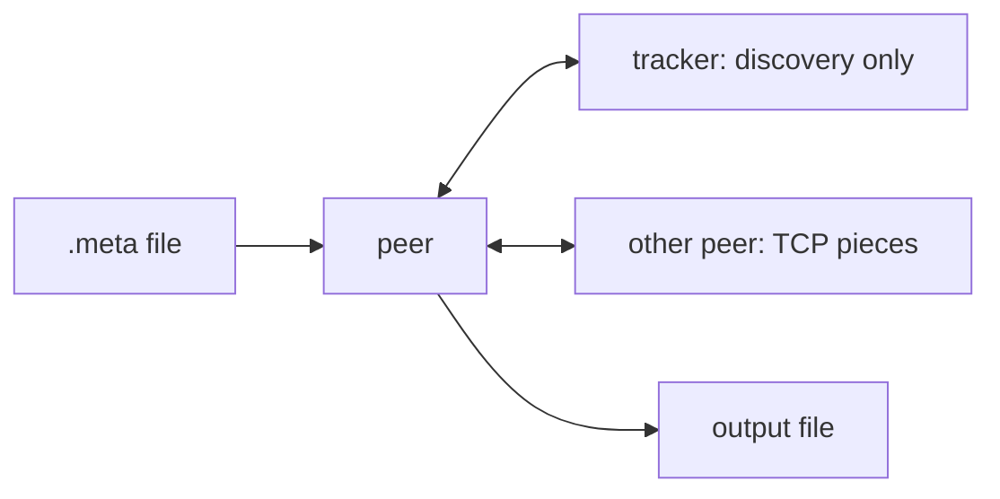

# Design — implemented P2P BitTorrent Lite

## Scope
This localhost, single-file, TCP/POSIX-thread project distributes fixed-size pieces. It is inspired by BitTorrent, not compatible with BitTorrent. It has no DHT, NAT traversal, encryption, choking, free-rider policy, persistence at the tracker, or block-level requests.

## Components
`metainfo` makes expected file/piece hashes. `tracker` maps a file ID to endpoints. `peer` is both downloader and uploader. `protocol.c` frames TCP; `sha256.c` verifies data; the peer modules separate lifecycle, messages, and local pieces.

## Protocol
Handshake: 60 bytes: `P2PLITE1`, file ID, peer ID. Every later message is big-endian 4-byte length, 1-byte ID, payload. IDs are BITFIELD, HAVE, REQUEST, PIECE, CANCEL; CANCEL is defined but has no handling. TCP complete reads/writes use `recv_all`/`send_all`.

## Transfer and concurrency
Main initializes, listens, announces every three seconds, schedules, and cleans up. Listener accepts inbound sockets; every active connection gets a detached worker. `state_mutex` protects piece and connection state; per-socket `send_mutex` serializes sends. A worker verifies a received piece before `pwrite`, status update, and HAVE broadcast.

## Selection and logs
The coordinator requests up to four whole pieces per connection. `choose_rarest_piece` counts active source bitfields and chooses the least available candidate. `--log` writes per-peer CSV events. The test uses a short-lived original seeder then confirms downloader 17002 uploads to downloader 17003.

## Build/test
In Ubuntu WSL: `make clean && make all && make test`. The test creates metadata, runs tracker/seeder/two downloaders, uses `cmp`, and retains `logs/runs/<run_id>/`.
