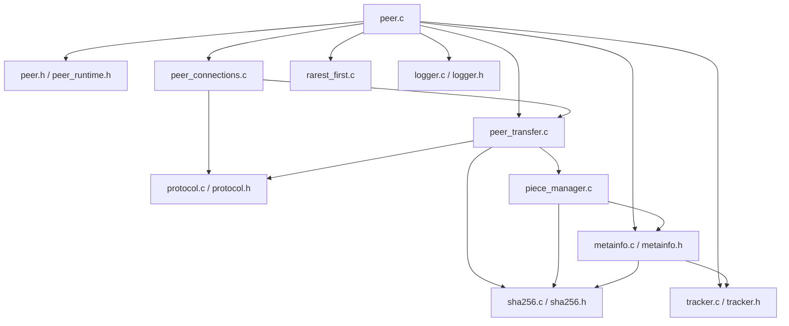

# Headers and shared types

This guide explains the header files used by the current `src/*.c` implementation. Header files generally declare types, constants, and functions; the corresponding `.c` files contain the executable implementation. Some values are `static` inside source files and are intentionally not part of the public interface.

## `include/common.h` — common platform includes and constants

This header defines common POSIX networking, threading, file, time, and C library includes used across modules. It also defines shared constants:

- `DEFAULT_PIECE_SIZE` = 16,384 bytes (16 KiB).
- `MAX_PEERS` = 32 peer-table slots.
- `PIPELINE_DEPTH` = 4 outstanding requests per connection.
- `SHA256_HASH_SIZE` / `FILE_ID_LEN` = 32 bytes for a SHA-256 digest/file ID.
- `PEER_ID_LEN` = 20 bytes.
- `HANDSHAKE_MAGIC` = `P2PLITE1`, eight bytes.
- `HANDSHAKE_LEN` = 60 bytes.

It also defines `BIT_SET`, `BIT_CLEAR`, and `BIT_CHECK`. These use a bitfield byte array to represent piece availability, with the high-order bit used first within each byte. Bitfields are compact: one bit per piece rather than one full byte per piece.

## `include/peer.h` — peer state and connection state

### `piece_status_t`

- `PIECE_MISSING`: no verified local copy and no request currently recorded.
- `PIECE_IN_FLIGHT`: requested from a peer and awaiting a response.
- `PIECE_VERIFIED`: digest matched and bytes were written successfully.

### `peer_conn_t`

Represents one remote connection in the peer table:

- `sock_fd`: TCP socket descriptor, `-1` when not open.
- `peer_id`, `ip`, `port`: remote identity/endpoint.
- `bitfield`: remote peer's advertised piece availability.
- `in_flight`: pending pipelined request count.
- `is_active`: active-connection flag.
- `send_mutex`: prevents simultaneous sends from interleaving.
- `thread`: worker thread handle (the worker is detached by connection setup).

### `peer_state_t`

Holds the local peer ID/port, open data-file descriptor, loaded `metainfo_t`, local bitfield, per-piece status and assignment arrays, count of verified pieces, bitfield length, fixed-size peer table, state mutex, logger, and running flag.

The `state_mutex` is essential because the main scheduling loop and per-peer worker threads may read/write shared piece and connection state concurrently. The current code does not place every read behind the mutex, so this should be described as the intended central synchronization mechanism rather than a proof that every shared access is perfectly synchronized.

## `include/peer_runtime.h` — globals shared across peer modules

Declares `extern peer_state_t g_state` and `extern int g_listen_fd`. `peer.c` defines them. `extern` means another source file may refer to the variables without defining another copy of them.

There is no `peer_runtime.c` in this project; the runtime header exists only to share declarations between source files.

## `include/peer_connections.h`

Declares:

- `peer_disconnect_locked(int peer_idx)` — closes a connection and reverts outstanding assignments; caller is expected to hold the state mutex.
- `peer_listener_thread(void *arg)` — thread routine that accepts incoming TCP connections and handshakes.
- `peer_connect_to_remote_peer(const char *ip, uint16_t port)` — connects to a peer and validates its handshake.

The internal helper `add_active_peer()` is `static` in `peer_connections.c`, so it is not visible to other translation units.

## `include/peer_transfer.h`

Declares `peer_send_request()`, `peer_send_bitfield()`, `peer_broadcast_have()`, and `peer_worker()`. Other send helpers in `peer_transfer.c` are `static` because they are only needed internally.

## `include/piece_manager.h`

Declares the three implemented helpers `piece_manager_length()`, `piece_manager_read()`, and `piece_manager_scan_existing()`. Despite the module name, receive-side hash verification and output writes currently remain in `peer_transfer.c`.

## `include/metainfo.h`

Defines `metainfo_t`, the metadata creation/loading/freeing/printing API, and `metainfo_piece_len()`. The `piece_hashes` member is a dynamically allocated array whose memory is released by `metainfo_free()`.

## `include/protocol.h`

Defines message IDs `MSG_BITFIELD` through `MSG_CANCEL` and declares generic byte helpers, handshake functions, framed message functions, and convenient senders. `MSG_CANCEL` is defined but currently has no action in the worker.

## `include/sha256.h`

Defines the streaming `SHA256_CTX` and declares `sha256_init()`, `sha256_update()`, `sha256_final()`, and `sha256_buffer()`.

## `include/tracker.h`

Defines `peer_endpoint_t`, hexadecimal conversion helpers, and `tracker_announce()`. The tracker server's registry types and server-only helpers are private to `tracker.c` under `TRACKER_MAIN`.

## `include/logger.h`

Defines `logger_t` with a file pointer, mutex, and monotonic start-time reference. It declares `logger_open()`, `logger_event()`, and `logger_close()`.

## Include and dependency map

## Build-system note

The same `.c` file can be compiled into different programs with different preprocessor macros. The Makefile defines `METAINFO_CLI` for the metadata utility and `TRACKER_MAIN` for the tracker server. That does not mean each source file always creates an executable; without the macro it provides functions to the peer or another build target.
