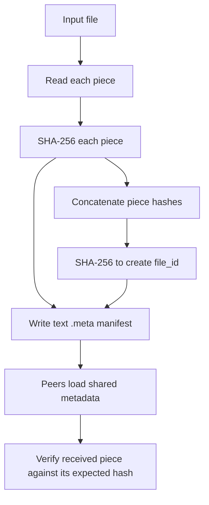

# `src/metainfo.c` — file metadata and piece hashes

## Purpose in one sentence

`metainfo.c` creates and reads the manifest that tells peers which file is being shared, how it is divided into pieces, and what SHA-256 hash each piece should have.

## Why this file exists

Peers need a common description of the file before they can exchange pieces. The metadata records the file size, piece size, piece count, file identifier, and expected hash for every piece. Separating this from network transfer means the peer can verify what it receives without trusting the sending peer.

## Where it fits

The public type and functions are declared in [`include/metainfo.h`](../../include/metainfo.h). The peer loads the manifest during `peer.c:main()`. `piece_manager.c` and `peer_transfer.c` use its piece-size/hash information; `protocol.c` sends the fixed-length file identifier in the handshake. The `metainfo` executable includes a CLI `main()` only when the Makefile defines `METAINFO_CLI`.

## Important data

`metainfo_t` includes:

- `filename`: original base name stored in metadata.
- `file_size`: total number of bytes.
- `piece_size`: configured maximum piece length.
- `piece_count`: number of pieces. The current creation code forces at least one piece even for an empty file.
- `file_id`: a 32-byte SHA-256-based swarm/file identifier.
- `piece_hashes`: dynamically allocated array containing `piece_count` consecutive 32-byte digests.

## Important functions

### `uint32_t metainfo_piece_len(const metainfo_t *meta, uint32_t piece_idx)`

Returns zero for a null metadata pointer or out-of-range piece index. Non-final pieces have `piece_size` bytes. For the final piece, it returns the remainder of `file_size % piece_size`; if the file size is an exact multiple, the final piece also has a full `piece_size`. This is important because the final piece may be shorter than all the others.

### `int metainfo_create(const char *input_path, const char *meta_path, uint32_t piece_size)`

1. Checks that paths are provided and `piece_size` is non-zero.
2. Opens the input as binary and reads its file size with `fstat()`.
3. Calculates the piece count by rounding file size up to a multiple of the piece size, then forces one piece for an empty file.
4. Allocates a hash array and one piece-sized read buffer.
5. Reads each piece and hashes the bytes actually read with `sha256_buffer()`.
6. Computes `file_id` as SHA-256 over the concatenated per-piece hashes—not directly over the original file bytes.
7. Writes a text manifest containing `NAME`, `SIZE`, `PIECE_SIZE`, `PIECES`, `FILE_ID`, `HASHES`, and then one hexadecimal hash per piece.
8. Frees resources and returns `0`; common open/allocation failures return `-1`.

The current loop does not explicitly check whether each `fread()` returned the intended piece length. The file is expected to remain readable and stable while metadata is generated.

### `int metainfo_load(const char *meta_path, metainfo_t *meta)`

Clears the output structure, reads the manifest line by line, parses the scalar fields, allocates the hash array when it sees `HASHES`, and parses up to `piece_count` hash lines using `hex_to_hash()`. It rejects a zero piece count at the hash-section start and rejects a file with fewer parsed hashes than expected. On a malformed piece hash, it closes the file and frees the allocated hash array.

The loader is a simple project-specific parser rather than a fully defensive general-purpose manifest parser. For example, the current implementation does not validate every numeric field or check the return value from parsing `FILE_ID`.

### `void metainfo_free(metainfo_t *meta)`

Frees `piece_hashes` if present and sets the pointer to null. It does not need to free the fixed-size filename or other scalar fields.

### `void metainfo_print(const metainfo_t *meta)`

Prints filename, size, piece size, piece count, and file ID in readable form. It uses `hash_to_hex()` to display the identifier.

### CLI `main()` under `METAINFO_CLI`

Supports:

```bash
./metainfo create <input_file> <output_meta> [piece_size_bytes]
./metainfo show <meta_file>
```

The default piece size is `DEFAULT_PIECE_SIZE` (16 KiB). If a supplied piece size parses as zero, the CLI falls back to the default. An unknown subcommand or missing arguments produces usage/error output.

## Metadata flow



## Example walkthrough

For a 40,000-byte file using 16,384-byte pieces, the piece count is three: two full pieces and a final piece of 7,232 bytes. The metadata contains three separate hashes. A downloader can use piece index `2` to find the expected digest and the byte offset `2 * 16384` to place that piece into its output file.

## Limitations and caution

The metadata file is text-based and project-specific. It is not the official `.torrent` bencoding format. The `file_id` is the digest of the array of piece hashes, so describing it as SHA-256 of the entire source file would be inaccurate. Metadata parsing could be hardened with range checks and stricter validation.

## Related files

- [`include/metainfo.h`](../../include/metainfo.h) — `metainfo_t` and API.
- [`sha256.md`](sha256.md) — digest implementation.
- [`tracker.md`](tracker.md) — hexadecimal conversion helpers and swarm identifier use.
- [`peer.md`](peer.md) — metadata loading during process initialization.
- [`piece_manager.md`](piece_manager.md) — piece lengths and existing-file scan.
