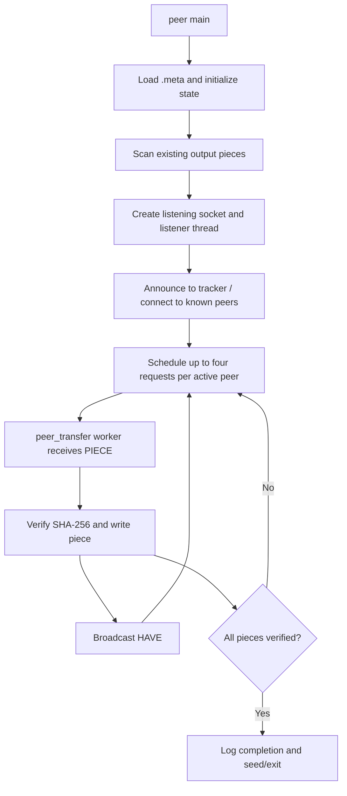

# `src/peer.c` — peer-process coordinator

## Purpose in one sentence

`peer.c` starts and coordinates one peer process: it loads metadata, initializes state, listens for connections, discovers peers, schedules piece requests, reports completion, and cleans up.

## Why this file exists

A transfer needs one place to own the process lifecycle and shared state. This file decides **when** to connect to the tracker, **when** to schedule more requests, and **when** a peer is complete. The details of accepting connections and processing wire messages have been moved to `peer_connections.c` and `peer_transfer.c`; file-piece helpers are in `piece_manager.c`.

## Where it fits

This file defines the global `peer_state_t g_state` and listening socket `g_listen_fd`, which are declared for other peer modules in [`include/peer_runtime.h`](../../include/peer_runtime.h). Its `main()` is the entry point for the `peer` executable. It coordinates these modules:

- `metainfo.c` for the manifest;
- `tracker.c` for peer discovery;
- `peer_connections.c` for connections and handshakes;
- `peer_transfer.c` for the per-peer worker and wire events;
- `rarest_first.c` for piece selection;
- `piece_manager.c` for scanning existing output data;
- `logger.c` for optional CSV events.

## Global process state

- `g_state`: all local peer state, including metadata, output file descriptor, local bitfield, per-piece status, peer connections, mutex, and logger.
- `g_listen_fd`: TCP listening socket used for inbound peer connections.
- `g_tracker_ip`, `g_tracker_port`, `g_has_tracker`: optional tracker endpoint settings.
- `g_is_seeder`: indicates the process is acting as a seeder. A file already containing all verified pieces is automatically treated as a seeder.
- `g_exit_on_complete` and `g_seed_time`: control completion/continued seeding behavior.
- `g_log_file`: optional log path supplied by `--log`.
- `g_start_time`: monotonic process start reference used for elapsed time and log entries.

## Important functions

### `static double get_time_s(void)`

Reads `CLOCK_MONOTONIC` and returns seconds as a floating-point value. A monotonic clock is suitable for elapsed durations because it is not intended to jump when wall-clock time is adjusted.

### `static void handle_sigint(int sig)`

Handles Ctrl+C by clearing `g_state.running` and closing the listening socket so the listener loop can stop. `SIGPIPE` is separately ignored in `main()` so a write to a closed socket does not terminate the process in the default way.

### `static void schedule_requests(void)`

This is the request scheduler.

1. Locks `g_state.state_mutex` and exits if all pieces are verified.
2. Walks the peer table, skipping inactive peers and invalid sockets.
3. While a peer's `in_flight` count is less than `PIPELINE_DEPTH` (currently 4), calls `choose_rarest_piece()` for that source peer.
4. Marks the selected piece `PIECE_IN_FLIGHT`, records which peer it was assigned to, and increments that connection's in-flight count.
5. Temporarily releases the state mutex to send the request, logs `piece_requested`, then locks again.

This is pipelining: the peer can have several requests outstanding to one connection before earlier responses arrive. The scheduler marks the piece in-flight before sending, which helps prevent another scheduling pass from selecting the same piece. If a connection is lost, `peer_disconnect_locked()` resets its assignments so the pieces can be requested again.

The scheduler relies on `peer_send_request()` to send the protocol message. The current selection is per source connection: `choose_rarest_piece()` counts active sources in the swarm, but only considers pieces advertised by the specific peer passed to it.

### `static void print_usage(const char *prog)`

Prints the actual usage synopsis and supported options: `--seed`, repeatable `--peer <ip:port>`, `--tracker <ip:port>`, `--exit-on-complete`, `--seed-time <sec>`, and `--log <file>`. The program also accepts a tracker IP and port as positional optional arguments after the required first three arguments.

### `int main(int argc, char **argv)`

The main coordinator carries out these stages.

#### 1. Parse arguments

Requires `<meta_file> <data_file> <my_port>`. Parses tracker settings, direct peers, seeder mode, completion behavior, seed duration, and optional CSV path. Invalid local ports are rejected.

#### 2. Load metadata and initialize state

Loads `.meta`, creates a peer identifier that incorporates the local port and current time, initializes the state mutex, allocates the local bitfield, per-piece status array, assignment array, and a bitfield for each peer slot. Assignment entries begin at `-1` to mean “not assigned to a peer.” Peer socket descriptors begin at `-1`.

#### 3. Open the output file and detect reusable pieces

Opens the data file with `O_RDWR | O_CREAT`. `piece_manager_scan_existing()` hashes complete pieces already in that file and marks matching pieces as verified. If every piece is verified, the process becomes a seeder; otherwise the output is resized to the target file size with `ftruncate()`.

#### 4. Open optional logging

If `--log <file>` was given, calls `logger_open()`. The application prints an error if opening fails but continues without that CSV log.

#### 5. Start the TCP listener

Creates a TCP socket, sets `SO_REUSEADDR`, binds to `INADDR_ANY` and the peer's port, listens, then launches `peer_listener_thread()`.

#### 6. Initiate connections and discover peers

Attempts each `--peer` endpoint. If a tracker was configured, announces approximately every three seconds, receives peer endpoints, and attempts to connect to each one. Duplicate/self connections are filtered in the connection module.

#### 7. Schedule requests and report completion

While running, schedules requests until all pieces are verified. On first observing completion, prints the number of verified pieces, elapsed time, and active-peer count, and logs `download_complete`. With `--exit-on-complete`, it breaks immediately; otherwise a completed downloader typically remains available for five seconds by default, or for `--seed-time` seconds if a duration was supplied. A seeder with a positive seed-time also exits when its time limit has elapsed.

#### 8. Shut down and free resources

Stops the run loop, closes peer sockets, frees remote bitfields, closes listening and output file descriptors, closes the optional logger, frees piece tracking arrays, and frees metadata hashes.

## Piece state

`piece_status_t`, declared in `include/peer.h`, has three values:

- `PIECE_MISSING`: the peer does not currently have a verified copy.
- `PIECE_IN_FLIGHT`: a request for the piece is outstanding.
- `PIECE_VERIFIED`: content has matched the expected SHA-256 digest and was written to the local file.

The local bitfield advertises only verified pieces. `verified_count` is used to detect completion.

## Architecture sequence

## Errors and limitations

The code checks many important failures such as metadata load, output-file open, socket creation, bind/listen, and connection module failures. Some initialization calls such as allocations, `pthread_create()`, `pthread_mutex_init()`, and certain `setsockopt()` calls are not checked in every location. Shutdown is designed for the normal path and Ctrl+C, but the process does not implement a sophisticated coordinated join for all detached peer workers.

This is the coordinator, not the full protocol implementation. It does not itself parse `BITFIELD`, `HAVE`, `REQUEST`, or `PIECE`; that happens in `peer_transfer.c` and `protocol.c`.

## Likely viva questions

**Q: Why is `peer.c` not responsible for all networking code?**

A: Keeping coordination separate from the details of each connection makes the code easier to read. `peer.c` decides when work should happen, while other modules handle connection lifecycle and message processing.

**Q: What prevents the same piece from being requested repeatedly by the scheduler?**

A: Before the request is sent, `schedule_requests()` changes its status to `PIECE_IN_FLIGHT` while holding the state mutex.

**Q: Is a peer only a downloader or only a seeder?**

A: A peer can upload any verified piece it has while downloading other pieces. A peer that already has every verified piece is treated as a seeder.

**Q: Does this implement full BitTorrent choking?**

A: No. The inspected code does not implement choking/unchoking or free-rider handling.

## Where to look next

- [`peer_connections.md`](peer_connections.md) — how sockets become active peer entries.
- [`peer_transfer.md`](peer_transfer.md) — how messages and pieces are handled.
- [`rarest_first.md`](rarest_first.md) — the selector called from `schedule_requests()`.
- [`headers-and-shared-types.md`](headers-and-shared-types.md) — shared runtime structures.
