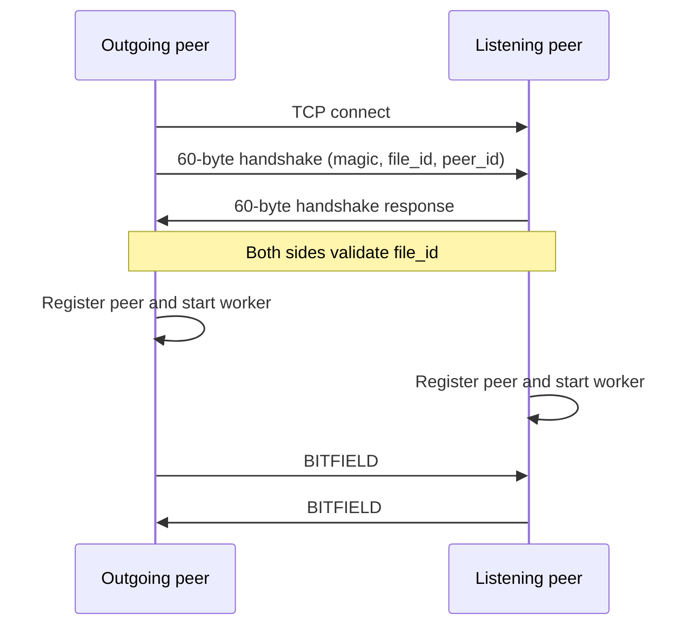

# `src/peer_connections.c` — connections, handshakes, and disconnects

## Purpose in one sentence

`peer_connections.c` turns incoming and outgoing TCP sockets into validated active peer connections and cleans up connections that fail.

## Why this file exists

Peer setup has a lifecycle of its own: accepting a socket, exchanging the handshake, checking that both sides intend to share the same file, recording the remote endpoint, and starting a worker. Keeping this out of `peer.c` leaves the coordinator focused on the overall transfer.

## Where it fits

Declarations are in [`include/peer_connections.h`](../../include/peer_connections.h). The module uses shared globals from [`include/peer_runtime.h`](../../include/peer_runtime.h), handshake helpers from `protocol.c`, and `peer_worker()`/`peer_send_bitfield()` from `peer_transfer.c`. The listener thread is started by `peer.c:main()`.

## Important functions

### `void peer_disconnect_locked(int peer_idx)`

The caller is expected to hold `g_state.state_mutex`. The function returns if the entry is already inactive and has no socket. Otherwise it logs/prints the disconnection, closes the socket if valid, resets `is_active` and `in_flight`, then scans piece assignments. Any piece still marked `PIECE_IN_FLIGHT` and assigned to this peer is changed back to `PIECE_MISSING`, and its assigned peer becomes `-1`.

This reset matters because a request outstanding to a dead peer cannot be relied on to complete. The scheduler can try that piece from another peer.

### `static int add_active_peer(...)`

Private helper used only after a socket's handshake succeeds.

1. Locks the shared state mutex.
2. Rejects a duplicate active connection to the same IP/port.
3. Finds a free slot among `MAX_PEERS` (32).
4. Fills the socket, peer ID, IP, port, `in_flight` count, and active flag.
5. Initializes the connection's send mutex and clears its remote bitfield.
6. Sends the local bitfield through `peer_send_bitfield()`.
7. Starts a detached `peer_worker()` thread for this peer slot.
8. Prints and records `peer_connected`, then unlocks the state mutex.

If there is no slot or the endpoint is duplicated, it closes the new socket and returns `-1`. This helper treats a successful handshake as permission to create a connection entry; it does not by itself prove the remote has any pieces.

### `void *peer_listener_thread(void *arg)`

Runs an `accept()` loop while `g_state.running` is true and the listening socket remains valid.

For each incoming socket it:

1. Captures the remote IP and the source port from `accept()`.
2. Receives the remote handshake.
3. Checks the remote file ID against the local `g_state.meta.file_id`.
4. Rejects the connection if handshake receive fails or the file ID differs.
5. Sends the local handshake in response.
6. Calls `add_active_peer()` to record the connection and launch its worker.

`EINTR` from `accept()` causes the loop to retry. Other accept errors cause it to leave the loop. The thread does not create another handler thread per pending handshake; it completes each incoming handshake in the listener thread itself before registration.

### `int peer_connect_to_remote_peer(const char *ip, uint16_t port)`

Initiates an outgoing connection. It avoids connecting to the local peer's own `127.0.0.1`/`localhost` endpoint on the same port and returns early if the exact endpoint is already active. It then creates a TCP socket, applies short send/receive timeouts, converts the IPv4 string with `inet_pton()`, connects, sends the local handshake, receives the remote handshake, and checks that the remote file ID matches. Finally it registers the connection through `add_active_peer()`.

Returns `0` on success or an already-existing connection, and `-1` on failure. The function accepts numeric IPv4 addresses via `inet_pton()`; it is not a general DNS resolver for arbitrary hostnames.

## Handshake and connection direction

The incoming side sends the response handshake before registering; the outgoing side sends its handshake first and waits for the response. A connection can be rejected if the file identifier differs. That prevents accidental exchange between peers whose metadata identifies different swarms.

## Shared state and synchronization

The active peer table is stored in `g_state.peers`. `g_state.state_mutex` protects operations that change connection status and piece assignments. Each active peer also has a `send_mutex`, used by transfer code to prevent concurrent message sends from being interleaved on one TCP socket.

`peer_disconnect_locked()` must be called with the state mutex held; its name and callers reflect that contract. `peer_connect_to_remote_peer()` checks the table under the mutex, releases it while performing network operations, and then calls registration.

## Failure cases and limitations

- Invalid handshake magic, an unreadable handshake, or a different file ID leads to the accepted socket being closed.
- Failed `socket`, address parsing, `connect`, or handshake operations return failure and close the outgoing socket.
- Duplicate peers and peer-table exhaustion are rejected.
- Some calls such as `pthread_create()`, `pthread_detach()`, mutex initialization, and socket timeout setup do not have full error recovery.
- `peer_disconnect_locked()` resets requested pieces but does not implement a retry timer itself; retry occurs when the coordinator schedules requests again.

## Example walkthrough

A downloader announces to the tracker and receives `127.0.0.1:17001`. `peer.c` calls `peer_connect_to_remote_peer()`. The downloader opens TCP to port 17001, exchanges the 60-byte handshake, confirms the file ID, registers the remote connection, sends its own bitfield, and begins a worker thread to read the remote peer's messages. If the socket later closes, the worker calls `peer_disconnect_locked()` and assigned pieces return to the missing state.

## Likely viva questions

**Q: Why validate `file_id` during handshake?**

A: The peers must be talking about the same shared file/swarm before they exchange piece indexes and bytes.

**Q: Why keep a bitfield in each `peer_conn_t`?**

A: The local peer needs to know which pieces each remote peer claims to possess so it can choose a source for a missing piece.

**Q: Why reset in-flight pieces after disconnect?**

A: Otherwise a piece could remain marked as pending forever even though the peer that was meant to send it is gone.

## Where to look next

- [`protocol.md`](protocol.md) — handshake representation and message framing.
- [`peer_transfer.md`](peer_transfer.md) — worker thread and bitfield exchange.
- [`peer.md`](peer.md) — listener startup and tracker-based outgoing connects.
