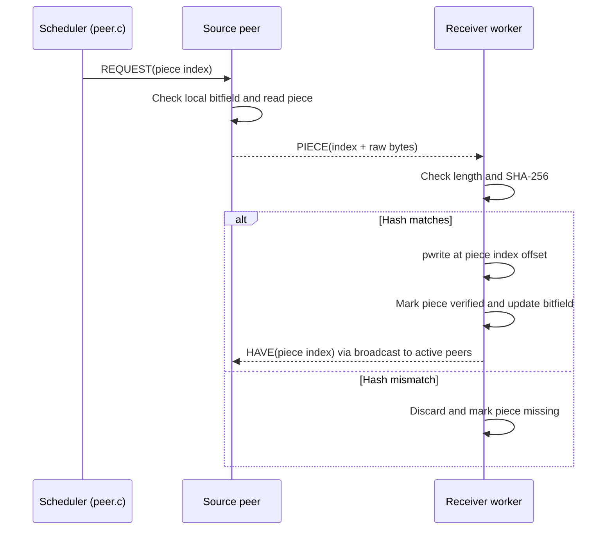

# `src/peer_transfer.c` — peer messages and piece transfer

## Purpose in one sentence

`peer_transfer.c` processes the messages on an established peer connection, including piece requests, piece uploads, piece downloads, verification, and availability announcements.

## Why this file exists

Once a TCP connection is established, it must continuously read complete protocol messages and respond according to their IDs. This is a separate responsibility from discovering or connecting peers. Each active connection gets its own worker thread, implemented by `peer_worker()`.

## Where it fits

The public functions are declared in [`include/peer_transfer.h`](../../include/peer_transfer.h). This module calls `recv_msg()`/`send_msg()` from `protocol.c`, piece reading from `piece_manager.c`, hashing from `sha256.c`, and disconnect cleanup from `peer_connections.c`. Shared state comes from `peer_runtime.h`.

## Message-sending helpers

### `static int peer_send_msg(peer_conn_t *peer, uint8_t msg_id, const void *payload, uint32_t payload_len)`

Checks for a null connection or invalid socket. It locks the connection's `send_mutex`, calls the generic `send_msg()` wire-protocol function, unlocks the mutex, and returns the result. The send lock prevents messages from different threads from being mixed together on one TCP byte stream.

### `static int peer_send_have(peer_conn_t *peer, uint32_t piece_idx)`

Converts the piece index to network byte order (`htonl`) and sends a `MSG_HAVE` message through `peer_send_msg()`.

### `int peer_send_request(peer_conn_t *peer, uint32_t piece_idx)`

Encodes the piece index in network byte order and sends a `MSG_REQUEST`. The scheduler in `peer.c` uses this after marking the piece as in-flight.

### `static int peer_send_piece(peer_conn_t *peer, uint32_t piece_idx, const uint8_t *data, uint32_t len)`

Builds a payload consisting of a four-byte network-order piece index followed by the raw piece bytes, then sends it as `MSG_PIECE`. It allocates temporary payload memory and frees it afterward. The project sends a whole piece at once; this function does not split pieces into request blocks.

### `int peer_send_bitfield(peer_conn_t *peer, const uint8_t *bits, uint32_t bitfield_bytes)`

Sends a `MSG_BITFIELD` payload to tell a newly connected peer which pieces the local peer currently has verified.

### `void peer_broadcast_have(uint32_t piece_idx)`

Locks global peer state and sends a `HAVE` message for the newly verified piece to every active connection with a valid socket. The purpose is to let other peers update their copy of this peer's bitfield and potentially request the new piece.

## Main function: `void *peer_worker(void *arg)`

The thread argument is the peer-table slot, converted through `intptr_t`. It repeatedly calls `recv_msg()` while the process is running and the connection is active.

If message receive fails, it locks state, calls `peer_disconnect_locked()`, unlocks, and ends the worker. Otherwise it dispatches the message by ID.

### `MSG_BITFIELD`

Accepts a bitfield only when the payload exists and its size exactly matches the local expected bitfield size. It copies the received bytes into the connection's `bitfield` under `state_mutex`.

### `MSG_HAVE`

Requires a four-byte payload, converts its piece index from network byte order, checks the index is in range, then sets the corresponding bit in the remote peer's bitfield under the state mutex.

### `MSG_REQUEST`

Requires a four-byte piece index and checks it is inside the file's piece range. Under the state lock it checks whether the local bitfield says the piece is available. If so, it asks `piece_manager_read()` to load exactly that piece from the output file. If reading succeeds and `peer_send_piece()` successfully sends the message, it prints an upload message and writes a `piece_uploaded` CSV event. The temporary data buffer is then freed.

This makes every completed downloader an uploader as well: once it verifies a piece, the local bitfield advertises it and this worker may serve it to another peer.

### `MSG_PIECE`

A piece message contains a four-byte piece index followed by bytes. The worker:

1. Extracts the index and data length.
2. Records `piece_received` before knowing whether the bytes are valid.
3. Locks shared state and decrements `in_flight` if it is positive.
4. Ignores an already-verified duplicate; otherwise checks that the data length matches the expected length for that piece.
5. Calculates SHA-256 and compares it with the corresponding metadata hash.
6. If the digest matches, writes the bytes at `piece_idx * piece_size` using `pwrite()`, marks the piece verified, clears its peer assignment, updates the local bitfield and verified count, records `piece_verified`, releases the state lock, broadcasts `HAVE`, and then locks the state again before continuing.
7. If hashing fails, prints a message, records `piece_hash_failed`, and makes the piece missing again so it can be requested later.
8. If the length is wrong or a file write fails, it does not mark the piece verified; it resets the relevant status/assignment.

`pwrite()` is used with an explicit offset, so pieces can be written into their correct positions even if they arrive out of order. SHA-256 is checked before the piece is accepted.

### `MSG_CANCEL` and unknown IDs

`MSG_CANCEL` currently has only a comment; the implementation does not cancel any recorded request. Unknown message IDs fall through without a dedicated error response. This should be described as a limitation rather than as a fully supported cancellation mechanism.

## Transfer path

## Thread safety and state

`state_mutex` protects shared piece state, connection availability information, and bitfields. `send_mutex` serializes socket writes for one connection. The worker owns the receive/dispatch loop for its connection. It frees each heap-allocated message payload after processing.

## Failure cases and limitations

- A `recv_msg()` error/disconnect triggers connection cleanup.
- Out-of-range `HAVE`/`REQUEST` piece indexes are ignored.
- Received data must have the expected piece length and hash before acceptance.
- File writes and upload sends are checked for success, but not all malformed or unknown messages are logged.
- `MSG_CANCEL` is not functionally implemented.
- The upload log event represents a successful local send call, not end-to-end confirmation of remote verification.
- The worker's message parsing uses the custom protocol from this project, not the standard BitTorrent wire protocol.

## Likely viva questions

**Q: Why verify a piece before advertising it with `HAVE`?**

A: Other peers should only rely on pieces that this peer has actually checked against the expected hash.

**Q: Why does `peer_send_msg()` use a mutex?**

A: More than one thread can try to send on the same socket. The mutex prevents their framed messages from being interleaved.

**Q: Why use `pwrite()`?**

A: It places the piece at its fixed file offset, regardless of the order in which pieces arrive.

**Q: What does `piece_received` prove?**

A: Only that a piece payload was received. `piece_verified` is the event that indicates the content passed the current hash and write path.

## Where to look next

- [`protocol.md`](protocol.md) — message IDs, frame layout, and `recv_msg()`.
- [`piece_manager.md`](piece_manager.md) — reading bytes from the output file for upload.
- [`peer_connections.md`](peer_connections.md) — how the worker is launched and cleaned up.
- [`logger.md`](logger.md) — meanings of transfer events.
