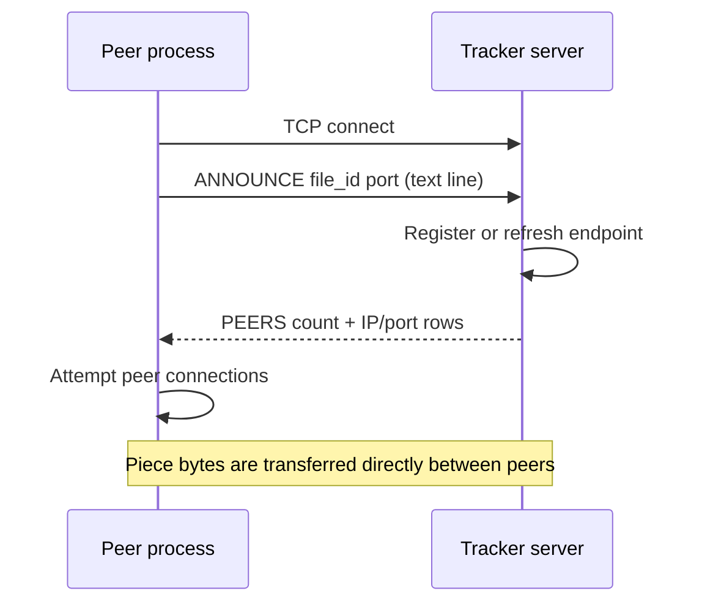

# `src/tracker.c` — peer discovery and tracker server

## Purpose in one sentence

`tracker.c` converts file identifiers to/from hexadecimal, implements a client helper to announce to a tracker, and optionally contains the tracker's TCP server when compiled with `TRACKER_MAIN`.

## Why this file exists

Peers need a way to learn which endpoints are participating in the same file swarm. The tracker provides that initial list; it does not carry file-piece data. Keeping tracker discovery separate from the peer-to-peer transfer makes the roles easier to understand.

## Where it fits

Public declarations are in [`include/tracker.h`](../../include/tracker.h). `metainfo.c` uses the hash conversion helpers when writing and printing metadata. `peer.c` calls `tracker_announce()` on a repeating interval. The Makefile compiles the same source file into different executables: as helper code for other binaries, and with `-DTRACKER_MAIN` to include the server `main()`.

## Data model

`peer_endpoint_t` carries a remote IPv4 string and port. The server's private in-memory `tracker_entry_t` stores a hexadecimal file ID, IP, port, and last-seen timestamp. The registry is limited to 256 entries by `MAX_TRACKER_ENTRIES` and protected by `g_tracker_mutex`.

## Helper functions

### `void hash_to_hex(const uint8_t hash[32], char hex[65])`

Converts each digest byte into two lowercase hexadecimal characters and terminates the result with `\0`, giving 64 visible characters plus the terminator.

### `int hex_to_hash(const char *hex, uint8_t hash[32])`

Checks that the input is non-null and has at least 64 characters, parses 32 pairs of hexadecimal characters with `sscanf()`, and stores the bytes. Returns `-1` on a parse failure and `0` on success. The function accepts extra characters after the first 64 because it checks only the minimum input length.

### `int tracker_announce(...)`

The client-side helper:

1. Clears the output peer count when possible.
2. Opens a TCP socket and configures three-second send/receive timeouts.
3. Parses the numeric tracker IPv4 address and connects to the tracker's port.
4. Converts the 32-byte file ID to 64 hexadecimal characters.
5. Sends a line like `ANNOUNCE <file_id_hex> <my_port>\n` using `send_all()`.
6. Reads response bytes until the tracker closes or the fixed response buffer is almost full.
7. Parses a first line `PEERS <count>` and subsequent lines containing `<ip> <port>`.
8. Returns the discovered endpoints up to `max_peers` and sets `peer_count`.

It returns `-1` for connection, invalid-IP, send, or response-format problems. It returns `0` after parsing a valid `PEERS` header, even if fewer peers were returned than the header count due to the output limit.

## Server functions under `TRACKER_MAIN`

### `static void register_peer(...)`

Locks the registry. If the same file ID, IP, and port are already registered, it refreshes `last_seen`; otherwise, if there is room, it appends a new entry and prints a registration message. It does not remove expired entries.

### `static void handle_client(int client_fd, const char *client_ip)`

Reads one request from the client socket. If it parses as `ANNOUNCE <file_id> <port>`, it registers the client and builds a response listing every current registry entry with the same file ID. The registry is locked while counting/copying matching entries. It sends the text response and closes the client socket. Malformed requests receive `ERR Invalid request\n`.

This is a simple line-based application protocol over TCP, not the length-prefixed peer wire protocol from `protocol.c`.

### `int main(int argc, char **argv)` under `TRACKER_MAIN`

Requires one port argument, validates the numeric range, creates a TCP socket, sets `SO_REUSEADDR`, binds to `INADDR_ANY` and the chosen port, starts listening, and then handles clients in a loop. It obtains the connecting client's IP from the accepted socket and calls `handle_client()`.

The server handles each accepted client synchronously in the main loop; it does not spawn a thread per client. It uses a mutex to protect its registry, but synchronous handling means one slow client can delay handling of others.

## Tracker request flow

## What the tracker knows and does not do

It stores endpoint membership for a file ID and returns those endpoints. It does not store or transmit file pieces, select rarest pieces, verify SHA-256 data, or coordinate each request. Those operations happen in peer processes. Its registry exists only in memory and is lost when the tracker stops.

## Limitations and edge cases

- The registry has a hard maximum of 256 entries and no expiry cleanup despite tracking `last_seen`.
- Tracker clients and server use numeric IPv4 addresses; `inet_pton()` does not resolve arbitrary hostnames.
- Client response collection waits for socket closure or the buffer limit; the server closes after responding.
- `handle_client()` performs one `recv()` and assumes the request line arrives in that read; it is a simple local demo protocol, not a robust streaming parser.
- The server is synchronous rather than concurrent.
- Some parse and send results are handled simply rather than exhaustively.

## Likely viva questions

**Q: Why use a tracker if the project is peer-to-peer?**

A: The tracker only helps peers find each other. The actual piece data is sent directly between peers, so the tracker is not a central file server.

**Q: Does the tracker know which pieces every peer has?**

A: Not in this implementation. Each peer shares its piece bitfield with connected peers directly.

**Q: What happens if the tracker stops after peers are connected?**

A: Existing peer TCP connections can still exchange pieces, but new discovery/connection attempts that depend on the tracker will fail.

## Where to look next

- [`metainfo.md`](metainfo.md) — how file IDs are formed and serialized.
- [`peer.md`](peer.md) — periodic announcements and peer connection attempts.
- [`protocol.md`](protocol.md) — contrast the binary peer wire protocol with the tracker's text request.
